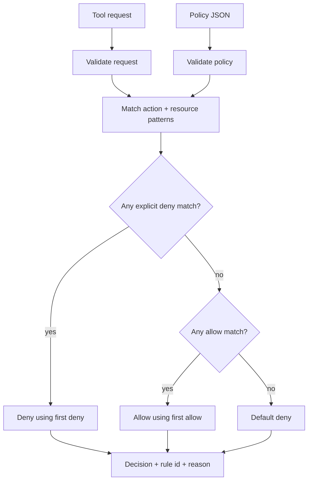

# Tool Policy Playground — security model

## Purpose

Tool Policy Playground demonstrates a simple host-side authorization boundary for tool-using AI agents.

The model or caller can request an action against a resource, but the policy evaluator makes the final decision. The default is deny, explicit deny rules take precedence over allow rules, and every decision explains which rule was selected.

The important security idea is separation of responsibilities:

- the model can propose;
- ordinary application code authorizes;
- unknown actions remain blocked by default.

## Decision flow



## Policy contract

A policy must contain:

```json
{
  "default": "deny",
  "rules": [
    {
      "id": "allow-calendar-read",
      "effect": "allow",
      "action": "calendar.read",
      "resource": "calendar://work/*"
    }
  ]
}
```

Each rule requires string values for:

- `id`;
- `action`;
- `resource`;
- `effect`, which must be either `allow` or `deny`.

The evaluator rejects policies that do not explicitly use `default: deny`.

## Request contract

Each request needs an action and a resource:

```json
{
  "request_id": "req-17",
  "action": "calendar.read",
  "resource": "calendar://work/today"
}
```

Both values must be strings.

## Matching behaviour

Matching uses Python's case-sensitive `fnmatch.fnmatchcase`.

A rule matches only when both its action pattern and resource pattern match the request.

For example:

```json
{
  "id": "allow-project-files",
  "effect": "allow",
  "action": "file.read",
  "resource": "project://docs/*"
}
```

can authorize a request such as:

```json
{
  "action": "file.read",
  "resource": "project://docs/architecture.md"
}
```

but does not authorize an unknown action or a resource outside that pattern.

## Precedence

The evaluator follows three steps:

1. collect all matching rules;
2. choose the first matching explicit deny when one exists;
3. otherwise choose the first matching allow;
4. otherwise deny by default.

This means an explicit deny overrides an allow even when the allow appears earlier in the rule list.

Within rules of the same effect, list order matters because the first matching rule is selected.

## Why default deny matters for agents

Tool-using models can produce unexpected requests because of ambiguous instructions, prompt injection, hallucination, or ordinary model error.

A default-allow design makes every unknown action a potential capability expansion. Default deny reverses that assumption: adding a new tool or resource does not automatically make it reachable.

This playground therefore models the host application as the final security boundary rather than treating model output as trusted authorization.

## What this project does not solve

This is a learning project, not a production policy engine. It does not implement:

- user or workload identity;
- authentication of the policy file;
- cryptographic request signing;
- consent or approval tokens;
- rule expiry;
- environment or tenant scoping;
- rate limits;
- argument-level validation beyond action/resource strings;
- audit-log persistence;
- policy versioning;
- semantic understanding of resources;
- protection against every wildcard misconfiguration.

The glob-based matcher is intentionally simple and can be too broad if a rule author writes an unsafe pattern.

## Production hardening

A production tool gateway would normally add:

- authenticated caller identity;
- typed tool schemas and argument validation;
- least-privilege scopes;
- short-lived approval or consent tokens for sensitive actions;
- resource ownership checks;
- policy versioning and change review;
- durable audit logs;
- explicit environment and tenant boundaries;
- deny rules for sensitive namespaces;
- tests for overlapping rules and wildcard edge cases;
- structured policy languages or established authorization systems where appropriate.

## Example threat scenarios

### Prompt injection requests a new tool

A retrieved document tells an agent to invoke `shell.exec`, but no matching allow rule exists.

Result: **deny**, because unknown actions fall through to the default.

### Broad allow overlaps a sensitive resource

A general file-read allow matches a path, but a specific deny also matches that resource.

Result: **deny**, because explicit deny rules take precedence.

### Model invents a resource

The model requests a plausible-looking resource that the application never anticipated.

Result: **deny** unless a policy rule explicitly covers it.

## Interview walkthrough

A concise explanation is:

> The project separates tool selection from tool authorization. The model may ask to use a capability, but a deterministic host-side policy checks both the requested action and resource. Explicit denies win, known allows are permitted, and everything else is denied. The main lesson is that model output should be treated as an untrusted request, not as permission.

A useful follow-up point is that this code demonstrates the boundary, while a production implementation would need identity, typed arguments, durable auditing, and a less error-prone policy model.
